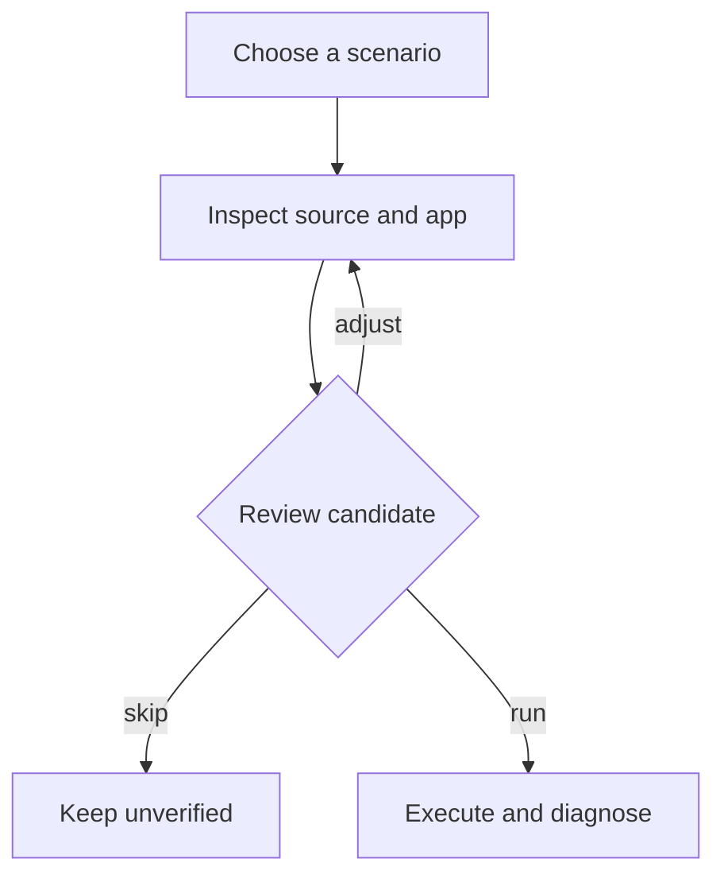

<p align="center">
  <picture>
    <source media="(prefers-reduced-motion: reduce)" srcset=".claude-plugin/icon.png">
    
  </picture>
</p>

<h1 align="center">Playwright Testgen</h1>

<p align="center">Grounded Playwright tests. Human review before execution.</p>

<p align="center">
  <a href="https://github.com/isikmert1/playwright-testgen/actions/workflows/ci.yml?query=branch%3Amain"></a>
  <a href="LICENSE"></a>
  <a href="https://nodejs.org/"></a>
</p>

Turn a written scenario into a reviewable Playwright end-to-end test, or discover
scenarios worth covering. Testgen is a [Claude Code](https://code.claude.com/)
plugin built on the [official Playwright CLI](https://github.com/microsoft/playwright-cli)
for browser exploration. Your project's own Playwright runner executes the
approved spec, using its existing configuration, fixtures, and test layout.

## What Testgen adds

- **Grounding and discovery.** Connect source, existing tests, and live UI to
  proposed scenarios, locators, and assertions.
- **Intent across handoffs.** Carry written criteria through validated handoffs
  for the active scenario and approved spec.
- **A review checkpoint.** Choose `run`, `adjust`, or `skip` for each candidate
  before test execution.
- **Scoped roles.** Separate discovery, writing, and execution, with tool access
  by role and hook checks on run-specific paths, browser origins, and commands.
- **Bounded repair.** Limit repair attempts, preserve approved intent, and report
  product or environment problems separately from test defects.
- **Optional mutation verification.** With a compatible adapter and separate
  approval, apply a criterion-linked product change in a disposable Git worktree
  and check whether the test catches it. Unavailable checks remain unverified.

## Prerequisites

- Claude Code **2.1.295+** and Node.js **22.13+**, with npm available to Claude.
- Git and an application repository with at least one commit.
- Matching local `playwright` and `@playwright/test` packages in the target
  project, plus the browser required by its Playwright configuration.

## Install

From the Git root of the application you want to test, install the official
browser CLI and its project-local skill, then add Testgen's marketplace:

```sh
npm install -g @playwright/cli@latest
playwright-cli install --skills
claude plugin marketplace add isikmert1/playwright-testgen
claude plugin install playwright-testgen@playwright-testgen
```

The plugin installs at user scope by default. See
[Claude Code's installation guide](https://code.claude.com/docs/en/discover-plugins)
for other scopes. Start a fresh Claude Code session from the application's Git
root so Testgen's startup hook loads.

On macOS, Linux, and WSL, start a dedicated Testgen session with its built-in
tools explicitly enabled. These hosts omit native file search by default:

```sh
claude --tools Agent,AskUserQuestion,Bash,Edit,Glob,Grep,Read,SendMessage,Skill,TaskStop,Write
```

## Quick start

**1. Check your project.** In Claude Code, run:

```text
/playwright-testgen:setup
```

Setup selects the target Playwright package and configuration, checks runtime
and browser prerequisites, and inspects existing test layout, fixtures, and
locator conventions. It respects the project's package manager and asks when
package or configuration choices are ambiguous. It asks before installing
dependencies, saving a local profile, or capturing authentication. It does not
generate or execute tests.

**2. Describe one scenario.** Start your app with its usual command and describe
the behavior to check. Provide the app URL if it is not already clear from the
selected configuration or your current session; Testgen asks when it needs one.
For example, on a sign-in form:

```text
/playwright-testgen:testgen "Enter a valid synthetic password, clear and blur Username, and verify the required-field message and a disabled Sign In button."
```

Testgen explores the relevant source and live UI, writes one candidate spec, and
reports its lint or Playwright collection result for review.

**3. Review the candidate.** At the checkpoint, choose:

| Choice   | What happens                                                      |
| -------- | ----------------------------------------------------------------- |
| `run`    | Run the approved spec and diagnose failures with focused repairs. |
| `adjust` | Return your feedback to Author and review the revised candidate.  |
| `skip`   | Keep the generated spec without executing it; mark it unverified. |

The `run` option requires validation to pass.

## Usage

### Discover scenarios

If you are unsure what to test, run the command without a scenario:

```text
/playwright-testgen:testgen
```

Explorer uses source, existing tests, recent Git history, and the live UI to
propose useful scenarios. Each proposal includes evidence for the expected
behavior, source/test references, and any prerequisites or open questions.
Review up to five proposals, edit or narrow them as needed, and select one or
more. Testgen processes your selections one at a time, with a separate candidate
review before each test can run.

### Use a role on its own

You can also make an explicit natural-language request in Claude Code:

| Role     | Example request                                            |
| -------- | ---------------------------------------------------------- |
| Explorer | `Use Testgen Explorer to find account settings scenarios.` |
| Author   | `Use Testgen Author to draft a display-name update test.`  |
| Healer   | `Use Testgen Healer to repair tests/account.spec.ts.`      |

Explorer returns proposals. Author returns an unexecuted candidate. Healer works
on one existing failing spec after its intent and execution scope are approved.
Each standalone request stops when that role's work is finished.

## How it works



Coordinator, the top-level Claude Code conversation, checks readiness and manages
handoffs, approvals, and cleanup.
Explorer proposes scenarios, Author writes the candidate, and Healer executes
the approved spec. Product and environment failures are valid stopping outcomes;
the workflow does not require every run to end with a passing test.

## Project and authentication setup

Setup can remember repository and testing facts locally; the saved profile does
not store the app URL. Rerun setup when your Playwright or authentication setup
changes. Generation still rechecks the running app and browsers for each scenario.

For authenticated scenarios, Testgen can reuse a compatible project fixture or
an approved storage-state file, or offer a browser where you sign in yourself.
Authentication state stays outside model context. Human-assisted capture prepares
local state; CI authentication needs a project-owned mechanism.

Testgen works within the existing test setup. Generation does not install
dependencies or rewrite Playwright configuration or CI. Its hooks constrain the
delegated agents; they are guardrails, not an operating-system sandbox.

## Contributing

Reproducible real-project scenarios, small sample apps, and difficult generation
or repair examples are welcome. Use public or permission-cleared code, synthetic
data, and sanitized results. See [Contributing](CONTRIBUTING.md) for how to share
an example, report a bug, or check a code change.

See [Architecture](docs/architecture.md) for component ownership and runtime
boundaries, and [Evaluations](evals/README.md) for installed-plugin checks.

## License

[Apache-2.0](LICENSE).
